<p align="center"></p>

# The kidney cancer metabolome: a metabolomics analysis in the LSMA Analysis Lab

**What does clear cell renal cell carcinoma do to the small molecules of the cell, and do the changes follow the genes and proteins?**

This repository is a worked example from the **LSMA Analysis Lab**, the analysis platform of the [London School of Multiomics & AI](https://lsma.co.uk). The full analysis was run in the lab, without writing code: upload of a public metabolite table, quality control, normalisation, exploration, differential abundance and a multivariate model. The report, figures and tables it produced are here, with a validation in an independent cohort and against the enzymes measured in the companion analyses.

| | |
|---|---|
| **Data** | The metabolic atlas of clear cell kidney cancer (Hakimi et al., *Cancer Cell* 2016, Memorial Sloan Kettering), tissue metabolomics by mass spectrometry (Metabolon), from the open [Zenodo archive](https://doi.org/10.5281/zenodo.7348648) of Benedetti et al. |
| **Samples** | 280: tumour and normal kidney from the same 140 patients |
| **Metabolites** | 577 named metabolites; 500 kept after quality control |
| **Comparison** | tumour vs adjacent normal kidney, paired by patient |
| **Lab module** | Metabolomics (workflow version 1.0.0) |
| **Lab run time** | **1 min 0 s** for the whole analysis (the table uploads in about 1 s) |
| **Validation** | An independent MSKCC cohort (18 other patients) run through the same lab workflow (30 s), a robustness re-run (1 min 0 s), and the enzymes from the [proteomics](https://github.com/MultiOmics-Intelligence/lsma-lab-proteomics-kidney-cancer-cptac) and [bulk RNA-seq](https://github.com/MultiOmics-Intelligence/lsma-lab-bulk-rnaseq-kidney-cancer-tcga-kirc) analyses |
| **Result** | **Replicated**: 95% of the strong changes go the same way in the independent cohort (ρ = 0.80), and six key metabolites move with their enzymes |

---

## Biological question and aim

**Question.** The companion repositories show which genes and proteins change in clear cell kidney cancer. Metabolites are the end of that chain: the sugars, amino acids, lipids and other small molecules that the enzymes make and use. Which metabolites change in the tumour, and do they match what the genes and proteins predict?

**Hypothesis.**
- If the tumour stores glycogen (the reason its cells look "clear"), glycogen and its breakdown products should accumulate.
- If the mitochondria are turned down (shown in the proteomics), metabolites of the citric acid (TCA) cycle such as fumarate should fall.
- Metabolites should change in the same direction as the enzymes that make or remove them, even when those enzymes were measured in other patients.

**Aims**
1. Check the quality of 280 tissue metabolomes and keep only reliably measured metabolites.
2. Find the metabolites that are higher or lower in the tumour, accounting for the patient.
3. Test whether tumour and normal can be told apart from all metabolites together, with honest cross-validation.
4. Repeat the analysis in an independent cohort, and once more without the samples flagged by quality control.
5. Check the key metabolites against their enzymes at the protein and RNA level.
6. Show each step as it is run in the LSMA Analysis Lab, so a student can repeat it.

---

## Background: the metabolism of clear cell kidney cancer

**Clear cell renal cell carcinoma (ccRCC)** is often called a metabolic disease. Loss of the *VHL* gene (see the [mutation analysis](https://github.com/MultiOmics-Intelligence/lsma-lab-somatic-mutations-kidney-cancer-tcga-kirc)) makes the cell behave as if it were short of oxygen. It then rewires its metabolism:
- **Glucose is burned by glycolysis** and the mitochondria are turned down (the Warburg effect, seen at protein level in the [proteomics analysis](https://github.com/MultiOmics-Intelligence/lsma-lab-proteomics-kidney-cancer-cptac)).
- **Glycogen and fat are stored.** Under the microscope, the dissolved glycogen and fat leave the cells looking empty, or "clear", which gives the cancer its name.
- **Antioxidants rise.** Glutathione protects the tumour from the damage of reactive oxygen.

**Metabolomics** measures hundreds of these small molecules at once. Here, frozen tissue was measured by mass spectrometry, and each metabolite was named by matching it to a library of known standards. The values are signal intensities: they compare amounts between samples, not absolute concentrations.

Hakimi and colleagues published this cohort in 2016. They reported "broad shifts in central carbon metabolism, one-carbon metabolism, and antioxidant response" in the tumours.

---

## Key findings

1. **The tumour metabolome is very different from normal kidney.**
   - **405 of 500 metabolites change** (adjusted p < 0.05): 217 higher and 188 lower in the tumour (Figure 1).
   - **221 change at least two-fold:** 115 higher and 106 lower.
   - **A model built on all metabolites tells tumour from normal almost perfectly.** It also predicts samples it was not trained on (OPLS-DA: Q2 = 0.90, permutation p = 0.005; Figures 4–5).
2. **A glycogen store** (Figure 2). The strongest increases are glycogen breakdown products, which are the remains of a large glycogen store: **maltotriose** (51-fold, log2 fold change +5.68), **maltose** (+5.06) and **maltotetraose** (+4.15). Sugar phosphates rise with them: glucose-6-phosphate (+3.19), glucose-1-phosphate (+3.77) and fructose-6-phosphate (+2.75).
3. **More antioxidant.** Reduced **glutathione** is 15-fold higher (+3.86), as is cysteine-glutathione disulfide (+3.75). This is the antioxidant response reported by Hakimi et al.
4. **A broken TCA cycle and an oncometabolite.**
   - **Fumarate** (−1.74) and **malate** (−1.22) are lower, as expected when the mitochondria are turned down.
   - **2-hydroxyglutarate** is 4-fold higher (+1.99). This is an "oncometabolite" known to build up in kidney cancer when its removing enzyme, L2HGDH, is lost.
   - **Citrate** is higher (+2.87), in line with fatty acid synthesis (see Validation).
5. **Immune suppression.** **Kynurenine** is 7-fold higher (+2.87) and its source, **tryptophan**, is lower (−2.18). The enzyme IDO1 makes kynurenine, which helps tumours escape T cells.
6. **Lower in the tumour.**
   - Several **lysophospholipids** (1-palmitoyl-GPE, −5.02).
   - **N-acetylaspartate** (−3.45) and **myo-inositol** (−1.93).
   - Metabolites the healthy kidney handles or excretes, such as **hippurate** (−3.36) and **vanillylmandelate** (−3.81).

Evidence labels from the lab: the differential abundance and the OPLS-DA model are *statistically supported*; the pathway readings are *biological interpretation*.

---

## Quality control and PCA

| Check | Result |
|---|---|
| Metabolites | 577 named metabolites uploaded; 300 unnamed features (Metabolon "X-" compounds) were left out because they can't be interpreted |
| Filtering | **500 kept**; 77 removed because they were measured in fewer than half of the samples of both groups (Figure QC2) |
| Missing values | 24% of the uploaded values, mostly metabolites below the detection limit; after filtering, 15% were filled in with half of the lowest measured value |
| Normalisation | probabilistic quotient normalisation (PQN), which corrects each sample for how concentrated it was; then log2 (Figures QC3–QC4) |
| Flagged samples | 3 tumours with very low total signal (Figure QC1); kept in the main analysis, then removed in a robustness re-run (see Validation) |
| Pooled QC samples | none in the public data, so metabolite reproducibility over the run couldn't be checked |

**PCA (Figure QC5).**
- **PC1 (23.5% of all variation) separates tumour from normal**, with one tumour sample among the normals.
- **PC2 (11%) is mostly patient-to-patient variation:** the patient explains 52% of it (Figure QC6).
- **Run day, sex, age, stage and grade explain almost none of the main components.** The samples were measured on several days, but every patient's pair was run on the same day, so the paired model removes any day effect.

| | |
|---|---|
| 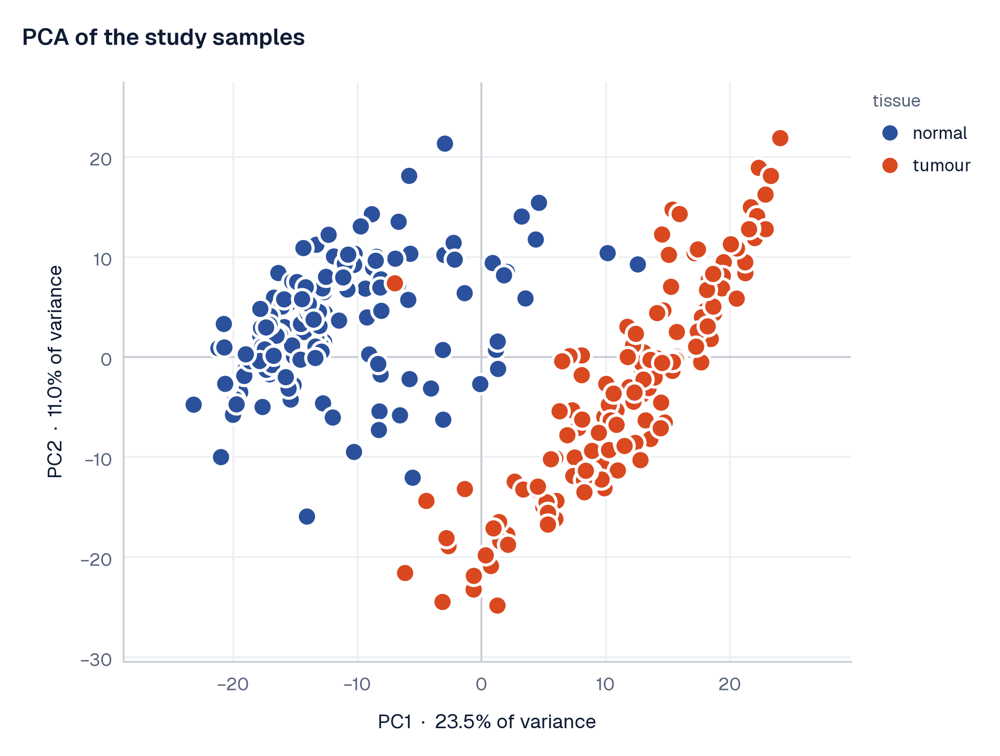 **QC5.** PCA: tumour and normal separate on PC1. | 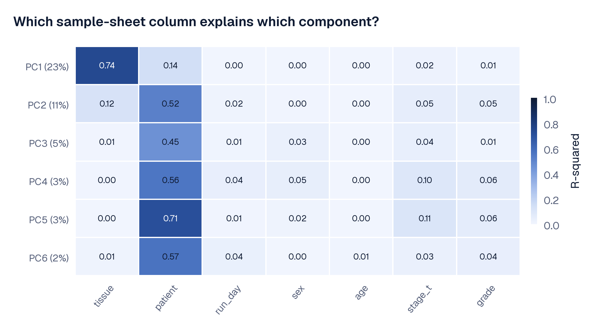 **QC6.** Which sample details explain each component: tissue for PC1, the patient for the rest. |
| 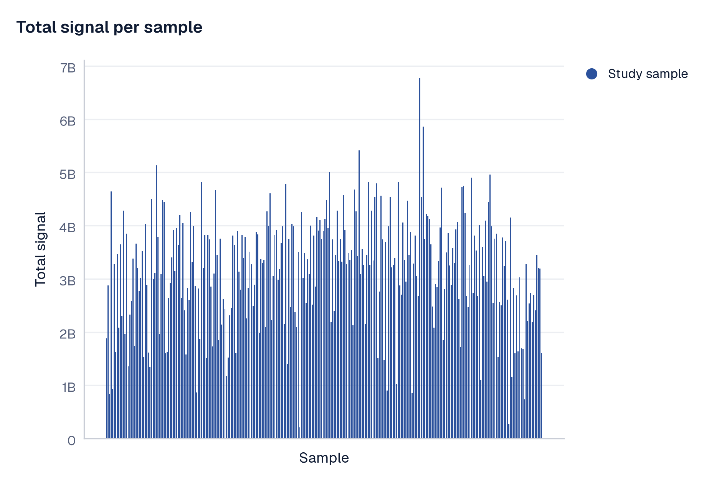 **QC1.** Total signal per sample; three tumours are very low. | 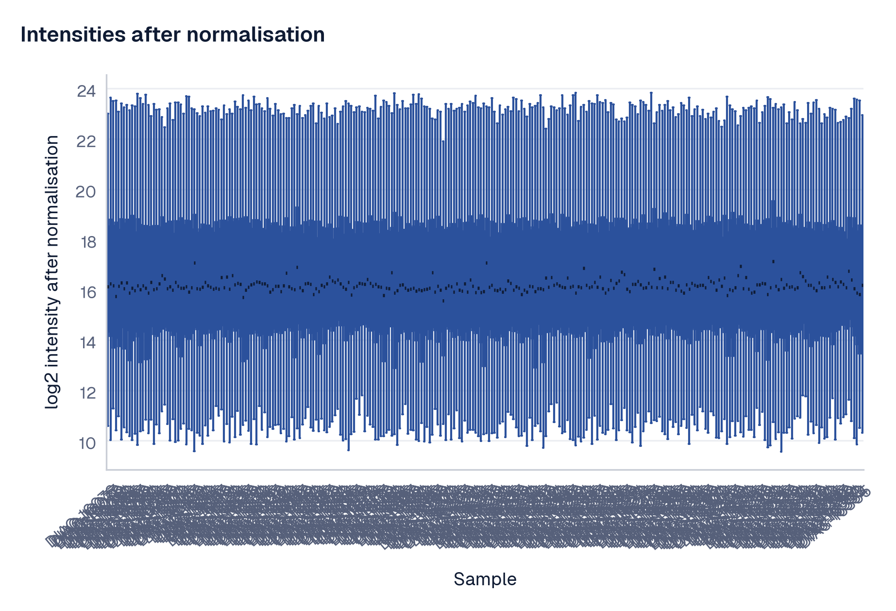 **QC4.** Values after PQN normalisation. |

Filtering (QC2), intensities before normalisation (QC3) and the 50 most variable metabolites (QC7) are in [`figures/`](figures).

---

## Figures

| | |
|---|---|
| 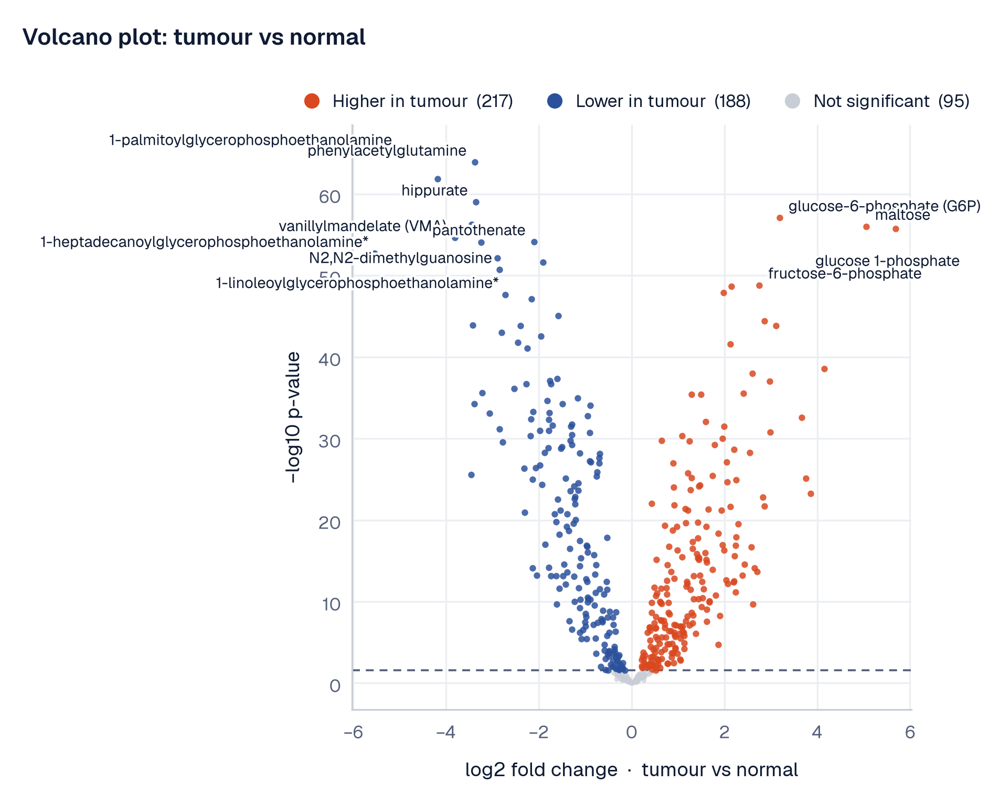 **Figure 1.** Volcano plot: 217 metabolites higher and 188 lower in the tumour. | 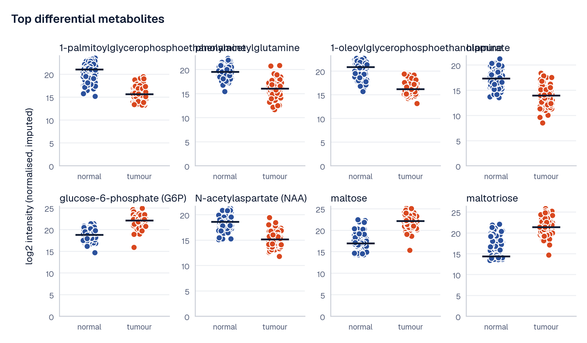 **Figure 2.** The most significant metabolites. |
| 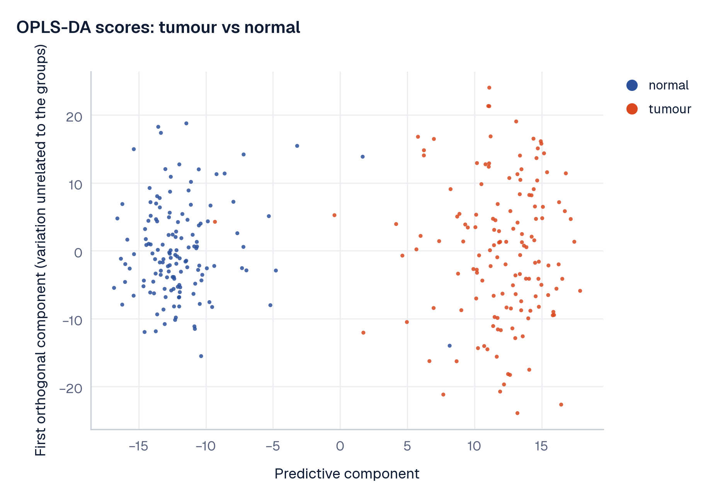 **Figure 4.** OPLS-DA: tumour and normal separate on the predictive component. | 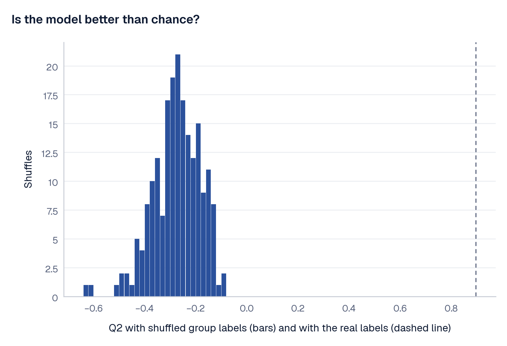 **Figure 5.** The model is far better than models built on shuffled labels. |

All figures are in [`figures/`](figures), as PNG (300 dpi) and vector PDF:

| File | What it shows |
|---|---|
| 01 | Volcano plot |
| 02 | Top metabolites |
| 03 | Heatmap of the most changed metabolites |
| 04 | OPLS-DA scores |
| 05 | Permutation test of the OPLS-DA model |
| 06 | Metabolites that drive the model (VIP) |
| qc-pca-* | Quality control and PCA |

## The full report

The lab's own report covers every stage: what was done, why, the checks, the results and their limits. It's available as a [**PDF**](report/LSMA-Analysis-Lab-report-kidney-cancer-metabolomics.pdf) or as [**HTML**](report/LSMA-Analysis-Lab-report-kidney-cancer-metabolomics.html) (download it and open it in a browser for the interactive version).

## Summary tables ([`results/`](results))

| File | Contents |
|---|---|
| `all_metabolites_tumour_vs_normal.tsv` | Every tested metabolite: pathway, fold change, p-value and adjusted p-value |
| `metabolites_higher_in_tumour.tsv` | Metabolites at least two-fold higher in the tumour (adjusted p < 0.05) |
| `metabolites_lower_in_tumour.tsv` | Metabolites at least two-fold lower |
| `changes_by_pathway.tsv` | Significant changes per chemical class |
| `opls_da_vip.tsv` | The importance of each metabolite in the OPLS-DA model |
| `sample_qc.tsv`, `metabolite_qc.tsv` | Quality metrics per sample and per metabolite |

---

## Workflow

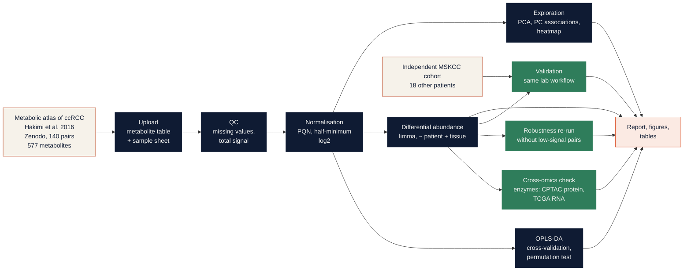

## How it was done

Every step below is a stage in the LSMA Analysis Lab, run with the settings in [`settings/analysis-settings.json`](settings/analysis-settings.json).

1. **Data.**
   - The lab does not yet import from metabolomics repositories, so the table was downloaded and uploaded, as the lab's documentation describes.
   - The original Metabolon table of the cohort (raw peak areas) came from the open Zenodo archive of Benedetti et al. (CC BY 4.0).
   - It was reshaped into one metabolite table (named metabolites in rows, with their pathway, KEGG and HMDB identifiers) and one sample sheet: tissue, patient, run day, sex, age, stage and grade. No values were changed.
2. **Sample preparation.** The groups were set to tumour vs normal, with normal as the reference, and paired by patient.
3. **QC.** Metabolites were kept if measured in at least half of the samples of one group. The lab also checked total signal per sample, flagged outliers, and plotted the PCA and the missing values.
4. **Normalisation.** Probabilistic quotient normalisation, with the median of all samples as the reference. Values below the detection limit were set to half the smallest measured value of that metabolite, then all values were log2-transformed.
5. **Exploration.** PCA on Pareto-scaled data, the association of each component with the sample details, and a heatmap.
6. **Differential abundance.** limma with the patient in the model (`~ patient + tissue`), so each tumour is compared with its own normal kidney. Significant: adjusted p < 0.05 (Benjamini–Hochberg). There's no fold-change rule by default, because metabolite changes are often modest.
7. **Multivariate model.** OPLS-DA with Pareto scaling, 7-fold cross-validation and 200 permutations of the labels.

**Software:** R 4.5.2 and Bioconductor 3.21, with limma and ropls, in the versions listed in the settings file.

## The mathematics behind the methods

The standard forms of the methods used above, as the lab's code applies them. Metabolite $i$, sample $j$.

**Half-minimum imputation and probabilistic quotient normalisation (PQN).**

$$
x_{ij} = \tfrac{1}{2} \min_{k} x_{ik} \quad \text{if missing}, \qquad r_i = \mathrm{median}_{j}   x_{ij}, \qquad f_j = \mathrm{median}_{i} \frac{x_{ij}}{r_i}, \qquad y_{ij} = \log_2 \frac{x_{ij}}{f_j}
$$

$x_{ij}$ is the peak area. A value below the detection limit is first set to half the smallest measured value of that metabolite. The reference profile $r_i$ is the median of each metabolite over all samples, and $f_j$ is the most typical ratio of sample $j$ to it, so a more dilute sample has a smaller $f_j$. Dividing by $f_j$ removes the dilution, and the result is log2-transformed.

**Pareto scaling.**

$$
z_{ij} = \frac{y_{ij} - \bar y_i}{\sqrt{s_i}}
$$

$\bar y_i$ and $s_i$ are the mean and standard deviation of metabolite $i$. Dividing by the square root of the standard deviation (not by the standard deviation itself) keeps large changes important without letting the noisiest metabolites dominate. It is used for the PCA and the OPLS-DA model.

**Linear model with the paired design (`~ patient + tissue`).**

$$
y_{ij} = \beta_{i0} + \gamma_{i,p(j)} + \beta_{i1} x_j + \varepsilon_{ij}, \qquad \varepsilon_{ij} \sim \mathcal{N}(0, \sigma_i^2)
$$

$x_j$ is 1 for a tumour and 0 for normal kidney, and $\gamma_{i,p(j)}$ is the effect of the patient $p(j)$. So $\beta_{i1}$ is the log2 fold change of tumour over normal within the same patient. (The code fits one mean per tissue plus the patient terms and takes the contrast tumour − normal, which gives the same estimate.)

**limma moderated t-statistic.**

$$
\tilde t_i = \frac{\hat\beta_{i1}}{\tilde s_i \sqrt{v_i}}, \qquad \tilde s_i^2 = \frac{d_0 s_0^2 + d_i s_i^2}{d_0 + d_i}
$$

$s_i^2$ is the metabolite's residual variance on $d_i$ degrees of freedom, and $v_i$ the unscaled variance of the contrast from the design. Empirical Bayes estimates one prior variance $s_0^2$ on $d_0$ degrees of freedom from all metabolites, which steadies the variance of each one. $\tilde t_i$ is compared with a t distribution on $d_0 + d_i$ degrees of freedom.

**Benjamini–Hochberg adjustment.**

$$
p^{\text{adj}}_{(k)} = \min_{l \ge k}   \min\left( 1, \frac{m   p_{(l)}}{l} \right)
$$

$p_{(1)} \le \dots \le p_{(m)}$ are the sorted p-values of the $m$ metabolites tested. Calling metabolites at adjusted p < 0.05 keeps the expected share of false discoveries at 5%.

**OPLS-DA, cross-validation and the permutation test.**

$$
Z = t_p   p_p^{\mathsf T} + T_o P_o^{\mathsf T} + E, \qquad y = t_p   c + f, \qquad Q^2 = 1 - \frac{\sum_j (y_j - \hat y_{(j)})^2}{\sum_j (y_j - \bar y)^2}
$$

$Z$ is the Pareto-scaled data and $y$ codes each sample's tissue as a number. The predictive component $t_p$ carries the variation in $Z$ that predicts $y$; the orthogonal components $T_o$ carry variation unrelated to the groups. In $Q^2$, $\hat y_{(j)}$ is the prediction for sample $j$ from a model built without it (7-fold cross-validation), so $Q^2$ measures prediction of unseen samples, while $R^2Y$ only measures the fit to the samples the model was built on. The labels were shuffled 200 times and the model refitted each time; the permutation p-value is based on how many shuffled models reach the real model's $Q^2$. VIP ranks each metabolite's contribution to the model; values above 1 are above average.

**Spearman correlation (validation).**

$$
\rho = \mathrm{corr}\left( \mathrm{rank}(x), \mathrm{rank}(y) \right)
$$

The correlation of the ranks of the fold changes in the main cohort ($x$) and the independent cohort ($y$). It measures agreement in order, without assuming a straight-line relation.

---

## Validation

### 1. An independent cohort, through the same lab workflow
A second MSKCC tissue metabolomics study, from the same Zenodo archive, was uploaded and analysed with exactly the same settings.
- **The patients:** 18 other patients with ccRCC, with tumour and normal kidney from each, measured years later on a newer version of the platform.
- **Run time:** 30 s.
- **Some of these patients had received immunotherapy.** For patients with several tumour regions, the first region was used.
- **Matching:** metabolites were matched between the two studies by Metabolon compound ID, then by name or KEGG ID. **271 metabolites** were found in both and passed the filters in both.

| Metabolites | Matched | Same direction in the independent cohort | Also significant there |
|---|---|---|---|
| **Strong changes** (adjusted p < 0.05, at least two-fold) | 119 | **113 (95.0%)** | 90 |
| All significant changes | 225 | 200 (88.9%) | 123 |
| All matched metabolites | 271 | 224 (82.7%) | |

The fold changes correlate at **Spearman ρ = 0.80** (Figure V1, left).
- **Replicated:** the glycogen breakdown products (maltose +5.41, maltotriose +4.47), glucose-6-phosphate (+3.54), kynurenine (+1.94), fumarate (−1.23), hippurate (−3.15) and the lysophospholipids.
- **Not testable:** glutathione was measured in too few samples of the independent cohort to be tested.

### 2. Robustness: without the samples flagged by quality control
The main analysis was run again in the lab without the three tumours with very low total signal, and their matched normal samples (137 pairs, 1 min 0 s).
- 400 of the 405 significant metabolites stay significant (98.8%).
- The fold changes correlate at r = 0.9996.
- The OPLS-DA model is unchanged (Q2 = 0.90).

### 3. The metabolites move with their enzymes
Six key metabolites were compared with the enzymes that make or remove them. The enzymes were measured as proteins in the CPTAC cohort and as RNA in TCGA-KIRC: two more sets of patients.

| Metabolite (this analysis) | Enzyme | Enzyme protein (CPTAC) | Enzyme RNA (TCGA) | Reading |
|---|---|---|---|---|
| Maltotriose **+5.68** | GYS1, glycogen synthase | +1.44 | +0.84 | more glycogen made |
| Kynurenine **+2.87** | IDO1, makes kynurenine | +1.66 | +4.12 | more kynurenine made |
| 2-hydroxyglutarate **+1.99** | L2HGDH, removes it | **−1.36** | **−1.58** | less removed, so it builds up |
| Fumarate **−1.74** | FH, fumarate hydratase | −0.99 | −0.96 | the TCA cycle turned down |
| Citrate **+2.87** | ACLY, uses citrate to make fat | +1.25 | +1.41 | citrate feeds fatty acid synthesis |
| N-acetylaspartate **−3.45** | NAT8L, makes it | not measured | −6.61 | less made |

Every pair points the same way, across three molecular layers and three sets of patients.
- The 2-hydroxyglutarate result reproduces the finding of Shim et al. (*Cancer Discovery* 2014): L2HGDH is lost in kidney cancer and the oncometabolite builds up.

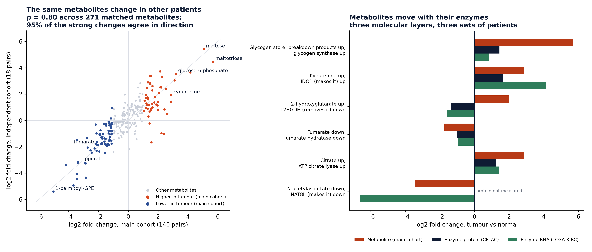

**Figure V1.**
- **Left:** fold changes in the main cohort against the independent cohort, for 271 matched metabolites.
- **Right:** six metabolites and their enzymes at protein and RNA level.

**Verdict: replicated.** Tables:
- [`validation/main_vs_independent_cohort.tsv`](validation/main_vs_independent_cohort.tsv)
- [`validation/replication_summary.tsv`](validation/replication_summary.tsv)
- [`validation/robustness_without_low_signal_samples.tsv`](validation/robustness_without_low_signal_samples.tsv)
- [`validation/metabolites_and_enzymes.tsv`](validation/metabolites_and_enzymes.tsv)

---

## Limitations

- **Relative, not absolute.** Values are signal intensities. They show which metabolites change, not their concentrations.
- **No pooled QC samples or blanks in the public data.** Metabolite reproducibility over the run and contamination couldn't be checked, so single metabolites deserve some caution.
- **Unnamed features were left out.** 300 unidentified compounds may hold real biology.
- **Tissue is a mixture.** Tumour samples contain blood, immune cells and stroma; normal samples may contain cortex or medulla. Some changes (hippurate, for example) may reflect the normal kidney's work of filtering and excreting, more than the tumour itself.
- **The independent cohort is small and partly treated.** Its 18 patients include some given immunotherapy, and it was measured on a newer platform version, which limits how many metabolites could be matched.
- **The data were uploaded, not imported.** The lab cannot yet import studies from the Metabolomics Workbench or MetaboLights; a table from either can be uploaded.
- **A teaching example, not clinical advice.** These results are for education and must not be used to diagnose or treat anyone.

---

## Repository structure

```
lsma-lab-metabolomics-kidney-cancer/
├── README.md                  this case study
├── LICENSE                    CC BY 4.0
├── assets/
│   └── lsma-lab-kidney-metabolome-banner.svg    animated banner
├── report/                    the LSMA Analysis Lab's full report
│   ├── LSMA-Analysis-Lab-report-kidney-cancer-metabolomics.pdf
│   └── LSMA-Analysis-Lab-report-kidney-cancer-metabolomics.html
├── figures/                   key figures, PNG (300 dpi) and vector PDF
│   ├── 01-volcano ... 06-vip
│   └── qc-pca-*                                quality control and PCA
├── results/                   summary tables (tab-separated)
│   ├── all_metabolites_tumour_vs_normal.tsv
│   ├── metabolites_higher_in_tumour.tsv
│   ├── metabolites_lower_in_tumour.tsv
│   ├── changes_by_pathway.tsv
│   ├── opls_da_vip.tsv
│   ├── sample_qc.tsv
│   └── metabolite_qc.tsv
├── validation/                independent cohort, robustness, enzymes
│   ├── validation-independent-cohort-and-enzymes.png / .pdf
│   ├── main_vs_independent_cohort.tsv
│   ├── replication_summary.tsv
│   ├── robustness_without_low_signal_samples.tsv
│   └── metabolites_and_enzymes.tsv
└── settings/
    └── analysis-settings.json          every parameter and software version
```

## Why we share this analysis

This is one of a series of worked examples from the **LSMA Analysis Lab**, published openly for five reasons:

- **To show what the lab does, on real data.** Each repository takes one public dataset through one lab module, from import to report, and shows every step, figure and setting. Nothing is hidden or polished after the fact: the report here is the one the lab produced.
- **To teach a complete analysis, not just a result.** Students see the parts that are usually skipped: quality control, the choice of statistics, an independent validation, and an honest list of limitations.
- **To earn trust by checking known biology first.** These analyses deliberately reproduce findings that are already well established, such as the hypoxia programme and the Warburg switch in kidney cancer. A method that gets the known answers right can be trusted with new questions.
- **To keep testing our own tools.** Every example is a real-world test of the lab. Running public data from start to finish shows what works and what needs fixing, and the fixes go back into the lab for every student. Improvements from this series so far: a more reliable import from NCBI GEO, automatic choice of the right cell-type markers for each tissue in single-cell analysis, and removal of sex-chromosome probes and a more robust DIABLO model in multi-omics.
- **To make the work open and repeatable.** The data are public, every parameter and software version is listed, and diploma students can repeat the same analysis in the lab themselves.

The series follows one cancer, clear cell kidney cancer, through every layer: genes, single cells, DNA methylation, enhancers, mutations, proteins, metabolites and lipids, all of them together in the [multi-omics analysis](https://github.com/MultiOmics-Intelligence/lsma-lab-multi-omics-kidney-cancer-tcga-kirc), and predictions from tumour RNA in the [machine learning analysis](https://github.com/MultiOmics-Intelligence/lsma-lab-machine-learning-kidney-cancer-tcga-kirc). Each repository links to the others. A second cancer, lung adenocarcinoma, is followed through all of these layers in one [full project](https://github.com/MultiOmics-Intelligence/lsma-lab-full-project-lung-adenocarcinoma).

These examples are for education and must not be used for medical decisions.

## Data source and credits

- **Data:**
  - The original metabolomics tables of the MSKCC kidney cancer cohorts, from the Zenodo archive of Benedetti E, Liu EM, Tang C, et al. (*A multimodal atlas of tumour metabolism reveals the architecture of gene–metabolite co-regulation*, [doi:10.5281/zenodo.7348648](https://doi.org/10.5281/zenodo.7348648), CC BY 4.0).
  - Enzyme comparisons: CPTAC ccRCC proteome ([proteomics repository](https://github.com/MultiOmics-Intelligence/lsma-lab-proteomics-kidney-cancer-cptac)) and TCGA-KIRC RNA ([bulk RNA-seq repository](https://github.com/MultiOmics-Intelligence/lsma-lab-bulk-rnaseq-kidney-cancer-tcga-kirc)).
  - No raw data are copied into this repository.
- **Reference studies:**
  - Hakimi AA, Reznik E, Lee CH, et al. An integrated metabolic atlas of clear cell renal cell carcinoma. *Cancer Cell* 2016;29:104–116.
  - Shim EH, Livi CB, Rakheja D, et al. L-2-Hydroxyglutarate: an epigenetic modifier and putative oncometabolite in renal cancer. *Cancer Discovery* 2014;4:1290–1298.
- **Methods:**
  - Dieterle et al., *Analytical Chemistry* 2006 (probabilistic quotient normalisation)
  - Ritchie et al., *Nucleic Acids Research* 2015 (limma)
  - Thévenot et al., *Journal of Proteome Research* 2015 (ropls, OPLS-DA)
- **Companion analyses** (same cancer):
  - [bulk RNA-seq](https://github.com/MultiOmics-Intelligence/lsma-lab-bulk-rnaseq-kidney-cancer-tcga-kirc)
  - [single-cell RNA-seq](https://github.com/MultiOmics-Intelligence/lsma-lab-single-cell-kidney-cancer-ccrcc)
  - [DNA methylation](https://github.com/MultiOmics-Intelligence/lsma-lab-dna-methylation-kidney-cancer-tcga-kirc)
  - [active enhancers](https://github.com/MultiOmics-Intelligence/lsma-lab-chip-seq-kidney-cancer-enhancers)
  - [somatic mutations](https://github.com/MultiOmics-Intelligence/lsma-lab-somatic-mutations-kidney-cancer-tcga-kirc)
  - [proteomics](https://github.com/MultiOmics-Intelligence/lsma-lab-proteomics-kidney-cancer-cptac)
  - [lipidomics](https://github.com/MultiOmics-Intelligence/lsma-lab-lipidomics-kidney-cancer)
  - [multi-omics](https://github.com/MultiOmics-Intelligence/lsma-lab-multi-omics-kidney-cancer-tcga-kirc)
  - [machine learning](https://github.com/MultiOmics-Intelligence/lsma-lab-machine-learning-kidney-cancer-tcga-kirc)

## Run it yourself

Diploma students of the London School of Multiomics & AI can repeat this analysis in the **LSMA Analysis Lab**:
1. **Datasets** → Upload → *Metabolite table*, with the metabolite table and the sample sheet (the reshaping is described under *How it was done*).
2. In sample preparation, set the groups to tumour vs normal and pair by patient.
3. Run **Metabolomics** with the comparison on `tissue`.

Find out more about the diplomas at [lsma.co.uk](https://lsma.co.uk).

## Licence

The text, figures and tables in this repository are shared under [Creative Commons Attribution 4.0 (CC BY 4.0)](https://creativecommons.org/licenses/by/4.0/): you may reuse them with credit to the London School of Multiomics & AI. The source data remain under their own terms (CC BY 4.0 on Zenodo; CPTAC and TCGA terms for the enzyme data).

---

**The LSMA Team**, Analysis Lab, London School of Multiomics & AI


